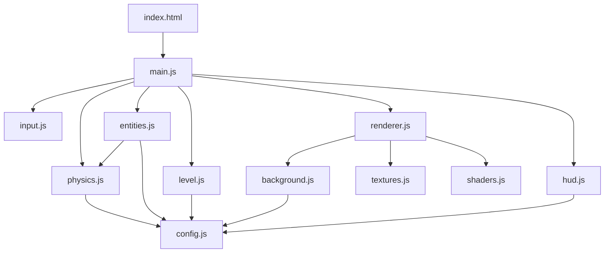

# Design guidelines for game2

Scope: These guidelines apply to the game2 project only.
Id: `DG-P-01` … `DG-P-12`

The project mirrors the decisions of `game1`. Each entry names the decision, the
reason, and the rejected alternative. The implementation treats these entries as
binding.

| Id | Topic |
|---|---|
| `DG-P-01` | Rendering approach |
| `DG-P-02` | File layout and module boundaries |
| `DG-P-03` | Physics and collision |
| `DG-P-04` | Camera and parallax |
| `DG-P-05` | Moon path |
| `DG-P-06` | Jet and bombs |
| `DG-P-07` | Enemies and death |
| `DG-P-08` | Test strategy |
| `DG-P-09` | Art style |
| `DG-P-10` | 2D texture style |
| `DG-P-11` | Opaque parallax silhouettes |
| `DG-P-12` | Game over as one DOM headline |

## How this project reads game1

`game1` holds the same game. This project took the rules, the numbers, and the
palette from the `game1` documentation and wrote its own modules from them. The
table names what each side contributes.

| From game1 | Used here as |
|---|---|
| `docs/spec.md` | The behaviour rules. The numbers in this file come from it. |
| `design-guidelines/game1.md` | The decisions `DG-P-01` to `DG-P-12` below. |
| `docs/references/` | The art research behind `DG-P-10` and `DG-P-11`. |

The one change: this game serves on port 8766, so both games can run at the same
time on one machine. `DG-P-01` to `DG-P-12` keep the port out of the code; only
`README.md`, `AGENTS.md`, and `tests/run-tests.mjs` name a port.

## The module graph



| Node | Role |
|---|---|
| `main.js` | game loop, wiring, test hook |
| `input.js` | keyboard state |
| `physics.js` | movement, collision, landing, stomp test |
| `entities.js` | player, enemies, jet, bombs |
| `level.js` | platforms, spawns, level reset |
| `hud.js` | lives and hearts in screen space |
| `renderer.js` | WebGL2 setup, draw queue, camera transform |
| `shaders.js` | three shader programs: quad, glow, sky |
| `textures.js` | runtime pixel-art atlas and its tiles |
| `background.js` | sky, stars, moon, city layers |
| `config.js` | tuning constants and colors |

## DG-P-01: Plain WebGL2, no engine, no build step

**Decision.** The game calls WebGL2 directly through the browser API. It uses no
game engine and no library. The code uses ES modules and needs no build step.
`python3 -m http.server 8766 -d src` serves `src/` as-is. `src/index.html` loads
`src/main.js` with a script tag of type module.

**Reason.** The scene draws textured quads, radial glows, and one gradient.
WebGL2 reaches 60 frames per second for this with zero dependencies. A bundler
would slow the edit-and-reload loop and change nothing else.

**Rejected.** Phaser or Three.js: a heavy engine for flat shapes, plus a
dependency tree. Canvas2D: the charter names WebGL as the technology.

## DG-P-02: File layout and module boundaries

**Decision.** The code lives in `src/` as ES modules. Each module owns one
concern. Logic modules import `config.js` and each other; no logic module
imports from `render/`. `main.js` calls logic first, then render. Render only
reads state; render never changes state. `main.js` writes the `window.__game`
hook. The one addition over `game1`: `hud.js` owns the lives and the hearts, so
`entities.js` stays about the world and `renderer.js` stays about drawing.

**Reason.** One module per concern keeps each test and each feature change
inside one file. A render rewrite then never touches physics. The heart rule is
the one part of the game a player reads constantly; a module of its own keeps it
findable.

**Rejected.** One big `game.js`: fast to start, hard to test. A class tree with
inheritance: too much machinery for a handful of entity types.

## DG-P-03: Fixed timestep and AABB collision

**Decision.** Physics runs on a fixed step of 1/120 second. `main.js`
accumulates real time and consumes it in fixed steps, at most 5 catch-up steps.
World units are pixels on a 960 x 540 logical viewport. The y axis grows
downward.

**Decision.** All physics numbers live in `config.js` and match `game1`:

| Value | Number |
|---|---|
| player box | 26 x 40 px |
| gravity | 2400 px/s² |
| jump velocity | -820 px/s |
| move speed | 320 px/s |
| max fall | 1100 px/s |
| land band | 10 px |
| stomp bounce | -380 px/s |
| death freeze | 1.0 s |

**Decision.** The physics module moves one axis at a time and treats every
object as an axis-aligned bounding box: move x, resolve, move y, resolve. A
landing needs a downward player and a foot inside the top 10 pixels of a
platform; the game then snaps the feet to the platform top and zeroes the
vertical velocity.

**Decision.** A stomp needs three facts at once: the boxes overlap after the
move, the vertical velocity is positive, and before the move the player's foot
sat no lower than the enemy's top plus 26 pixels. That slack covers one fast
step and a hop into the enemy from the side. Any other overlap is a side touch.

**Reason.** A fixed step keeps jump height and bomb timing identical at any frame
rate, so tests see stable numbers. The same numbers make the two games directly
comparable.

**Rejected.** A variable step with the frame delta: tests turn unstable. A
physics library: too much machinery for boxes and gravity.

## DG-P-04: Camera and three parallax layers

**Decision.** One camera follows the player horizontally and keeps the player at
the screen center, clamped to the level bounds. The level is 3200 px wide and one
screen tall, so the camera never moves vertically. The canvas scales the 960 x
540 logical viewport to the window.

**Decision.** Three silhouette layers sit behind the play field and move at the
camera position times their factor:

| Layer | Factor | Content |
|---|---|---|
| far | 0.15 | slim towers |
| mid | 0.35 | house rows |
| near | 0.60 | tall blocks |

The game builds the shapes once from the fixed seed in `config.js` and redraws
the list every frame.

**Reason.** Different factors create depth at near-zero cost. A fixed seed keeps
the city identical across runs, so screenshots stay comparable.

**Rejected.** A random city per run: tests lose a stable picture. Layer images:
heavy downloads and blurry edges when scaled.

## DG-P-05: Moon on an elliptical arc

**Decision.** One timer `moonTime` counts seconds since the level start. One pass
lasts exactly 10 seconds. The moon follows the top half of an ellipse in screen
space:

```
u = (moonTime mod 10) / 10          u in [0, 1)
x = cx - rx * cos(pi * u)
y = cy - ry * sin(pi * u)

cx = 480    cy = 560    rx = 560    ry = 470
```

At u = 0 the moon sits off-screen at the bottom left. At u = 0.5 it peaks at the
top center. The modulo wraps u, so the moon rises again at the bottom left. Both
arc ends sit below the screen edge, so the wrap reads as a natural rise.

**Reason.** The half-arc matches the spec words: rise bottom-left, pass
top-center, set bottom-right. A 10 s period lets a test watch one full pass.

**Rejected.** A full ellipse: the moon would sink through the city. A linear rise
and fall: a visible kink at the peak.

## DG-P-06: Jet every 6 seconds, bombs fall straight

**Decision.** One jet crosses the screen every 6 seconds, left to right, at 300
px/s at height 60 px. It leaves the screen before the next spawn. When the jet
sits within 50 px horizontally of the player, it drops one bomb straight below
itself. The game clamps the bomb x to the player x plus or minus 40 px, so every
pass threatens the player.

**Decision.** A bomb starts with zero velocity and falls with 1400 px/s². It
explodes on first contact with ground or a platform. The blast is a circle with
radius 90 px around the impact point and kills the player when the player center
sits inside that circle at the moment of the explosion. The explosion draws a
flash for 0.2 s.

**Reason.** Six seconds leaves about 4 seconds of clear sky between attacks. A
straight fall keeps the threat readable: the player judges timing, not drift.

**Rejected.** 4 s: too tight. 8 s: the jet becomes rare decoration. A bomb that
keeps the jet's forward speed: the impact point moves and reads unfair.

## DG-P-07: Edge patrol, stomp kill, full reset

**Decision.** Each enemy owns one platform, fixed at level build time. An enemy
walks at 60 px/s. Before each step it probes the point just past its next foot;
no ground or a wall there flips its direction.

**Decision.** A stomp under the `DG-P-03` rule kills the enemy: it plays a 0.3 s
squash, then the game removes it. Any other overlap between the player box and an
enemy box kills the player. On player death the game freezes the scene for 1.0 s,
then `level.js` resets platforms, enemies, the moon timer, the jet timer, and the
bomb list. The game resets state only and never reloads the page.

**Reason.** The ground probe needs no data beyond the level boxes. One reset
function gives every death cause the same behaviour.

**Rejected.** Enemies that chase the player: the spec says patrol. A knockback
instead of death: the spec says a side touch kills.

## DG-P-08: Headless Chrome with a window.__game hook

**Decision.** `tests/run-tests.mjs` runs the whole flow in plain Node:

```
1. start python3 -m http.server 8766 -d src as a child process
2. launch Chrome with puppeteer-core, executablePath /usr/bin/google-chrome-stable
3. open http://localhost:8766
4. run the assertions and save screenshots to shots/
5. close Chrome, stop the server, exit 0 or 1
```

The repo commits `package.json` and `package-lock.json` with a pinned
`puppeteer-core`. The package downloads no browser, because the machine has the
binary. `node_modules/` stays out of Git.

**Decision.** `main.js` always exposes the hook `window.__game`:

| Field | Contents |
|---|---|
| `state.time` | seconds since level start |
| `state.player` | x, y, vx, vy, alive |
| `state.enemiesAlive` | count |
| `state.bombs` | list of live bombs |
| `state.blasts` | list of live blasts with x, y, radius, age |
| `state.moonU` | moon phase u from `DG-P-05` |
| `state.jet` | active, x |
| `state.lives` | lives left in the run |
| `state.gameOver` | true while GAME OVER shows |
| `api.reset()` | level reset |
| `api.setPlayerPos(x, y)` | move the player for tests |

Every value is plain JSON data, updated once per frame.

**Decision.** The assertion set: move, jump, stomp, blast kill, three lives with
game over, moon advance and wrap, opaque city layers, platform layout. The run
saves `01-initial.png`, `02-jump.png`, `03-jet-bomb.png`, `04-gameover.png`, and
`04-moon-top.png` in `shots/`. A failed case also saves `fail-<case>.png`. The
folder `shots/` stays out of Git.

**Decision.** The port is the `PORT` variable of the test script, default 8766.

**Reason.** `puppeteer-core` is small and drives the system Chrome. The hook
keeps assertions about numbers separate from pixels, so an art change never
breaks a logic test. One default port per project lets both games run their tests
side by side.

**Rejected.** Playwright: it wants its own browser download. Pixel-diff tests:
too brittle for this scope.

## DG-P-09: Night city silhouette art

**Decision.** The scene shows a night city in silhouettes. One warm accent family
(windows, bombs, blast, hearts) sits against a cold, dark sky. `DG-P-10`
supersedes the flat-rectangle clause: the palette below keeps its force.

| Element | Color |
|---|---|
| sky top | `#0b1026` |
| sky bottom | `#241b45` |
| moon | `#f7e8c0` with a soft halo |
| far layer | `#262c52` |
| mid layer | `#141a33` |
| near layer | `#0c1024` |
| platforms | `#0a0d1e` with a `#2c3563` top edge |
| windows | `#ffc46b`, few, with a soft glow |
| player | `#54e0f0` |
| enemy | `#f0544e` |
| jet | `#a8d4ff` |
| bomb | `#ffd23f` |
| blast | `#ff8a3d` flash |
| heart, full | `#f0544e` |
| heart, spent | `#2a2f4a` |

**Decision.** The draw order: sky gradient, stars, moon glow, moon disc, far
layer, mid layer, near layer, platforms, entities, blasts, hearts.

**Reason.** Dark layers and bright characters make every screenshot readable at a
glance. Fixed colors keep the mood identical across runs.

**Rejected.** A daytime palette: window glow loses against a bright sky.
Per-object dynamic lighting: shader cost for little visual gain.

## DG-P-10: 2D texture style

**Decision.** The game draws city layers, platforms, and entities from 2D
textures, not from flat rectangles. One texture atlas holds all tiles and
sprites. The game generates the pixel-art atlas at runtime with a seeded random
generator and uploads it once at startup. No image file ships with the game. The
atlas scales with nearest-neighbour filtering, so tiles stay flat and
pixel-sharp. Tile interiors use one shared dark infill from the `DG-P-09`
palette. Each solid top edge gets a 1-pixel light line in the edge hue. Each
entity sprite carries a thin dark outline. One strong hue stays reserved for the
player and the hazards, never for city art. HUD hearts are exempt.

**Reason.** The spec rules out rectangles for city layers, platforms, and
entities. The research in `docs/references/README.md` gives the recipe: a
saturated hero against desaturated grounds (Celeste, Dead Cells, Sonic Mania),
one shared dark tile infill so the ground never competes with the player
(Celeste), a 1-pixel light top edge that names the standable surface (Celeste),
and dark outlines that separate sprites from any background (Super Meat Boy,
Hollow Knight). Runtime generation needs no importer and adds no asset file.
Sources: `https://ferdwolf.github.io/teemo.dev/games/celeste.html`,
`https://aran.ink/2020-07-27/a-tale-of-two-platformers-part-2/`,
`https://www.gamedeveloper.com/design/a-visual-analysis-of-the-art-of-i-dead-cells-i->`,
`https://www.mandible.net/writing/super-meat-boy`.

**Rejected.** Pre-made PNG atlases: an import pipeline and blur at non-integer
scales cost more than runtime generation. Linear filtering and mipmaps: they
smear the pixel look. High-resolution painted art: the Ori pipeline needs painted
layers, outside this scope.

## DG-P-11: Opaque parallax silhouettes

**Decision.** Every city layer draws fully opaque; city pixels keep alpha at 1.0.
The draw order runs sky and stars, moon, then the city layers back to front.
Buildings cover the moon wherever they overlap it; the moon shows only in the
gaps between silhouettes. Depth comes from the value steps, never from
transparency. The front layer uses the darkest values, the back layers lighter
and duller ones.

**Reason.** The spec demands opaque layers and forbids the moon shining through
buildings. Alpha-blended buildings leak the moon and break the hard silhouettes
of `DG-P-09`. Opaque stacking keeps every edge crisp and needs no blending state
changes. Super Meat Boy splits plane from depth with a value gap; Sonic Mania
stacks opaque horizontal parallax bands. Sources:
`https://www.styledex.com/design/super-meat-boy/`,
`https://www.gamedeveloper.com/design/the-sound-of-a-platformer-a-sonic-mania-post-mortem`.

**Rejected.** Semi-transparent building layers: the moon glowing through houses
reads as a bug. Blur-based depth of field: a blur pass costs shader time and the
opaque rule blocks it.

## DG-P-12: Game over as one DOM headline

**Decision.** The GAME OVER banner is one absolute-positioned `h1` element with id
`gameover` inside the stage wrapper, shown only while the run is over. It is the
only text node in the project. The heart HUD stays inside the canvas.

**Exception.** This lifts the canvas-only rule of `DG-P-02` for this one element.

**Reason.** A crisp system-font headline needs no glyph atlas, and the text never
moves, so it does not fight the WebGL scaling of the canvas.

**Rejected.** A canvas-drawn banner: it would need a font atlas for one sentence.
A DOM hearts row: the HUD must stay in canvas space to keep the screen-space HUD
in one place.

## Links

- Game behaviour: `docs/spec.md`
- Art references: `docs/references/README.md`
- Sibling project: `game1` (same spec, same decisions, port 8765)
- Shared style rules: `standards/rules/` and `standards/design-guidelines/common/`
